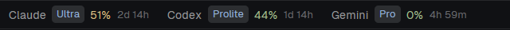

# Over9k Usage (Windows fit)

Claude's, Codex's and Gemini's (Antigravity CLI) 5-hour and weekly limits in one
line along the bottom of the window, each coloured green, yellow or red, with when it
resets. Hover a service to see every limit.



Fork of [herunan/herdr-over9k `over9k-usage`](https://github.com/herunan/herdr-over9k/tree/main/over9k-usage)
(commit `a53c200`). Upstream reads this computer's data through `sh`, `jq` and `cat`,
which Herdr on Windows usually can't find, so the strip stays empty. This version reads
local data with Herdr's `readTextFile` and Python instead. Other machines (Linux over
`hc`) still use upstream's `sh` path.

## What you see

- **The strip**, 30px high, on `chrome` with a 1px `border` above, 12px text. Per
  service: its name in `muted`, its plan in a 10.5px badge (`raised`, `accent` text),
  the most-used limit's percentage (`ansi2` under 50, `ansi3` from 50, `ansi1` from 80),
  and the time until it resets in 11px `dim`.
- **Claude · Show its limits** (an `accent` link) appears when Claude Code is installed
  but no Claude data has been saved yet. It runs upstream's `setup.sh` (needs `sh`+`jq`);
  on Windows use the tee below instead.

## Where the data comes from

| Service | File | Written by |
|---|---|---|
| Claude | `~/.cache/over9k/usage/claude.json` + plan from `~/.claude.json` | `claude-statusline-tee.py`, Claude Code's status line |
| Codex | newest `~/.codex/sessions/*/*/*/*.jsonl`'s last `rate_limits` | Codex itself; read by `codex-usage.py` |
| Gemini | `~/.cache/over9k/usage/antigravity.json` | `agy-statusline.py`, Antigravity CLI's status line |

Claude Code and Antigravity CLI hand their limits only to a status line program, so
those two need one setting each (below). Nothing here touches the network.

## Set up

1. Copy `mods/over9k-usage/` to `~/.config/herdr-app/mods/`. Needs `python` (3.8+) on
   PATH. `herdr-app check ~/.config/herdr-app/mods/over9k-usage` should pass.
2. **Place it.** `mod.json` says `place: bottom`; Herdr's first auto-dock wraps the whole
   layout root in a new column, which drops root-only fields (`titlebar`,
   `traffic_lights`). Prefer adding the block yourself, e.g. in the `work` column above
   the status bar: `{ "id": "over9k-usage", "type": "block", "content": { "mod": "over9k-usage" }, "size": { "px": 30 } }`.
   Don't give it the id `usage`: that switches it to Over9k's sidebar rows.
3. **Claude** (`~/.claude/settings.json`): wrap your existing status line command. The
   tee saves `rate_limits`, then passes stdin unchanged to whatever command follows and
   prints its output:
   ```json
   "statusLine": { "type": "command",
     "command": "python -I \"C:/Users/<you>/.config/herdr-app/mods/over9k-usage/claude-statusline-tee.py\" bunx -y ccstatusline@latest" }
   ```
   With no command after it, it saves and prints nothing.
4. **Antigravity CLI** (`~/.gemini/antigravity-cli/settings.json`): add a stacked line.
   agy does **not** strip quotes, so leave the path unquoted (no spaces allowed):
   ```json
   "statusLine": { "type": "command", "stack_with_default": true,
     "command": "python -I C:/Users/<you>/.config/herdr-app/mods/over9k-usage/agy-statusline.py" }
   ```
   Numbers update once agy has run.

## Changes from upstream

- `main.js`: `readJson` uses `readTextFile`; plan and account parsed from `~/.claude.json`
  in JS; Codex via `codex-usage.py` (`python -I`).
- New: `codex-usage.py`, `claude-statusline-tee.py`, `agy-statusline.py` (port of
  upstream's `agy-statusline.sh` usage part). Temp files are removed if the target is
  busy (Windows rename-over-open-file).
- Upstream's `setup.sh`, `claude-statusline.sh`, `api-cost.py` kept as-is for
  Linux/macOS.

## Done when

- `herdr-app check` passes and the strip shows Codex after a Codex session.
- After one Claude Code reply with the tee on, Claude shows its plan and percentage, and
  your own status line looks the same as before.
- After starting agy with its status line on, Gemini shows.

## Undo

Remove the two `statusLine` changes first (otherwise Claude's status line breaks when
the tee is gone), then delete the mod folder and its layout block.
